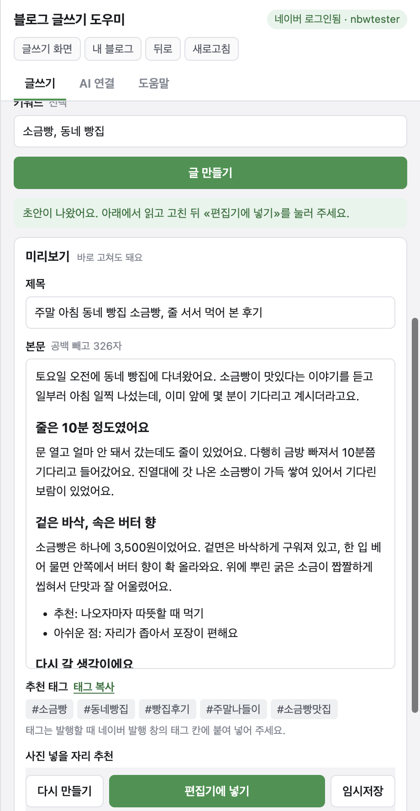
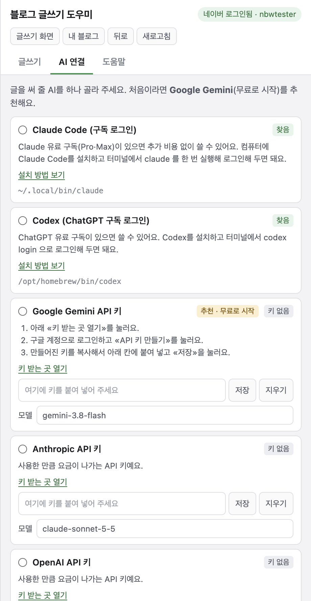

# 네이버 블로그 글쓰기 도우미

AI가 네이버 블로그 초안을 써 주고, 내 네이버 편집기에 넣어 **임시저장까지** 해 주는 컴퓨터용 앱이에요.
발행 버튼은 앱이 절대 누르지 않아요. 마지막 확인과 발행은 언제나 내가 직접 해요.

- 내 컴퓨터에서, 내 네이버 계정으로, 내 AI로 돌아가요. 따로 서버나 회원가입이 없어요.
- macOS와 Windows에서 쓸 수 있어요.

| 글쓰기 화면 | AI 연결 화면 |
|---|---|
|  |  |

> **먼저 읽어 주세요**
> - 이 앱은 네이버와 관계없는 **비공식** 도구예요.
> - 자동으로 글을 올리는 것은 네이버 이용약관과 맞지 않을 수 있어요. 그래서 이 앱은 **임시저장까지만** 하고, 내용 확인과 발행은 사람이 직접 해요.
> - AI가 쓴 글은 틀린 내용이 들어갈 수 있어요. 올리기 전에 꼭 읽고 고쳐 주세요. **글의 책임은 글쓴이에게 있어요.**
> - 광고·협찬·제품 제공을 받은 글이라면 공정거래위원회 «추천·보증 심사지침»에 따라 글 안에 분명히 밝혀 주세요. 필요하면 AI 도움을 받았다는 점도 알려 주세요.

---

## 이런 앱이에요

화면이 둘로 나뉘어 있어요.

- **왼쪽**: 진짜 네이버 블로그 화면이에요. 여기서 내 계정으로 직접 로그인해요.
- **오른쪽**: 글 만들기 패널이에요. 주제와 메모를 적으면 AI가 초안을 만들어요.

AI는 **«내 메모»에 적은 경험만** 내 이야기로 써요. 메모에 없는 후기나 숫자(가격·시간 등)는 지어내지 않도록 지시해 두었어요.

## 다운로드·설치

[Releases 페이지](../../releases)에서 내 컴퓨터에 맞는 파일을 받아요.

| 컴퓨터 | 받을 파일 |
|---|---|
| Mac (M1·M2·M3·M4 등 Apple 칩) | `naver-blog-writer-버전-mac-arm64.dmg` |
| Mac (Intel 칩) | `naver-blog-writer-버전-mac-x64.dmg` |
| Windows | `naver-blog-writer-버전-win-x64.exe` |

> 내 Mac이 어떤 칩인지 모르겠다면: 화면 왼쪽 위 사과 메뉴 → **이 Mac에 관하여** → «칩»에 Apple이라고 적혀 있으면 arm64, «프로세서»에 Intel이라고 적혀 있으면 x64예요.

### Mac에서 설치하기

1. 받은 `.dmg` 파일을 더블클릭해요.
2. 열린 창에서 앱 아이콘(**Naver Blog Writer**)을 **응용 프로그램(Applications)** 폴더로 끌어다 놓아요.
3. 응용 프로그램 폴더에서 **Naver Blog Writer**를 더블클릭해요.
4. 처음에는 «확인되지 않은 개발자» 또는 «Apple은 … 악성 코드가 없음을 확인할 수 없습니다»라는 창이 떠요. 개인이 만든 무료 앱이라 애플 인증을 받지 않아서 그래요. **완료**(또는 취소)를 눌러 창을 닫아요.
5. **시스템 설정 → 개인정보 보호 및 보안**으로 가서 아래로 내리면 «… 앱이 차단되었습니다» 옆에 **그래도 열기** 버튼이 있어요. 눌러요.
6. Mac 암호를 넣고, 다시 뜨는 창에서 **열기**를 눌러요. 다음부터는 그냥 열려요.

> 예전 macOS(14 이하)에서는 앱 아이콘을 **Control 키를 누른 채 클릭 → 열기**를 눌러도 돼요.

### Windows에서 설치하기

1. 받은 `.exe` 파일을 더블클릭해요.
2. 파란 창 «Windows의 PC 보호»가 뜨면 **추가 정보**를 누르고, 아래에 생긴 **실행** 버튼을 눌러요. (개인이 만든 무료 앱이라 마이크로소프트 인증서가 없어서 뜨는 창이에요.)
3. 설치가 끝나면 바탕화면이나 시작 메뉴의 **네이버 블로그 글쓰기 도우미**를 눌러요.

## 첫 실행: 네이버 로그인

1. 앱을 열면 왼쪽에 네이버 로그인 화면이 나와요.
2. 평소처럼 **내 아이디로 직접 로그인**해요. (2단계 인증, 보안 확인도 직접 해요. 앱은 로그인 화면을 건드리지 않아요.)
3. 로그인하면 오른쪽 위에 «네이버 로그인됨 · 내 블로그 아이디»가 떠요. 블로그 아이디는 앱이 자동으로 알아내요.
4. 로그인은 이 앱 안에만 저장되고, 다음에 열어도 유지돼요. 지우고 싶으면 «AI 연결» 탭 맨 아래 **이 앱에서 네이버 로그아웃**을 눌러요.

## AI 연결하기

오른쪽 패널의 **AI 연결** 탭에서 하나를 골라요. 처음이라면 **Google Gemini**를 추천해요.

### 추천: Google Gemini 무료 키 받기

1. **AI 연결** 탭에서 «Google Gemini API 키» 칸의 **키 받는 곳 열기**를 눌러요. 인터넷 창에 Google AI Studio가 열려요.
2. 구글 계정으로 로그인해요. 처음이면 이용약관 동의 창이 나와요. 확인하고 동의해요.
3. **API 키 만들기**(Create API key)를 눌러요. 프로젝트를 고르라고 하면 기본으로 나오는 것을 그대로 골라도 돼요.
4. 만들어진 키(긴 영문·숫자)의 **복사** 버튼을 눌러요.
5. 앱으로 돌아와 키 칸에 붙여 넣고(Mac은 ⌘+V, Windows는 Ctrl+V) **저장**을 눌러요.
6. «키 저장됨»이 보이면 끝이에요. 동그라미 선택이 Gemini로 되어 있는지 확인해요.

- 무료 사용량 안에서는 돈이 들지 않아요. 결제 정보를 넣지 않았다면 무료 한도를 넘어도 요금이 나가지 않고 «사용 한도를 넘었어요» 안내가 떠요. 조금 쉬었다 다시 해 주세요.
- 구글의 무료 등급에서는 입력한 내용이 구글 서비스 개선에 쓰일 수 있어요. 메모에 주민번호·전화번호 같은 개인정보는 적지 마세요.
- 모델 이름은 기본값(`gemini-3.8-flash`)을 그대로 두면 돼요. 나중에 구글이 이름을 바꾸면 이 칸에서 고칠 수 있어요.
- 키는 이 컴퓨터 안에만 암호화해서 저장돼요(Mac 키체인 / Windows 보호 저장소). 앱 화면이나 파일에 그대로 드러나지 않아요.

### Claude나 ChatGPT 구독이 있다면

이미 유료 구독이 있다면 추가 비용 없이 쓸 수 있어요. 대신 터미널(명령어 창)에서 한 번 설치·로그인해야 해요.

**Claude Code** (Claude Pro·Max 구독)

- Mac: 터미널을 열고 `curl -fsSL https://claude.ai/install.sh | bash` 를 붙여 넣고 Enter
- Windows: PowerShell을 열고 `irm https://claude.ai/install.ps1 | iex` 를 붙여 넣고 Enter
- 설치 후 `claude` 를 입력해 한 번 실행하고, 안내에 따라 로그인해요.

**Codex** (ChatGPT Plus·Pro 구독)

- Node.js가 있다면 `npm install -g @openai/codex`, Mac에 Homebrew가 있다면 `brew install --cask codex`
- 설치 후 `codex login` 으로 로그인해요.

설치가 끝나면 앱의 **AI 연결** 탭에서 **설치된 프로그램 다시 찾기**를 누르고, «찾음»이 뜬 항목을 골라요.

### Anthropic / OpenAI API 키

사용한 만큼 요금이 나가는 키도 쓸 수 있어요. 각 칸의 **키 받는 곳 열기**에서 키를 만들어 붙여 넣어요. 모델 이름은 칸에서 바꿀 수 있어요.

## 글 쓰는 순서

1. **글쓰기** 탭에서 주제를 적어요.
2. 글 종류(정보·꿀팁 / 제품 리뷰 / 맛집·카페 / 여행 / 일상 / 레시피), 말투(친근한 해요체 / 정돈된 합쇼체), 길이(짧게·보통·길게)를 골라요.
3. **내 메모**에 직접 겪은 일, 가격, 장소, 느낌을 편하게 적어요. 많이 적을수록 내 글다워져요. 메모가 비어 있으면 AI는 경험담 없이 정보 위주로 써요.
4. 키워드는 넣고 싶은 검색어가 있을 때만 적어요.
5. **글 만들기**를 눌러요. 보통 30초~2분 걸려요.
6. 미리보기에서 제목과 본문을 읽고 바로 고쳐요. 마음에 안 들면 **다시 만들기**.
7. **편집기에 넣기**를 누르면 왼쪽 네이버 글쓰기 화면에 제목과 본문이 들어가요. 들어가는 동안 왼쪽 화면은 누르지 말아 주세요.
8. 사진을 넣고(아래 참고) 내용을 다시 확인한 뒤 **임시저장**을 눌러요.
9. 마지막으로 왼쪽 네이버 화면의 **발행** 버튼을 내가 직접 눌러요.

- 미리보기 아래 **추천 태그**는 «태그 복사»로 복사해서, 발행할 때 네이버 발행 창의 태그 칸에 붙여 넣어요.
- 앱은 편집기가 비어 있을 때만 글을 넣어요. 이미 쓰던 글이 있거나 네이버가 «작성 중인 글이 있습니다» 창을 띄우면, 기존 글을 지우지 않도록 멈추고 알려 줘요. 왼쪽 화면에서 직접 고른 뒤 다시 눌러 주세요.

## 사진은 직접 넣어요

AI는 «사진 넣을 자리 추천»만 보여 줘요. 편집기에는 사진 자리 표시 같은 글자를 넣지 않아요.
내가 찍은 사진을 왼쪽 편집기의 사진 버튼으로 직접 넣어 주세요. 남이 찍은 사진은 저작권이 있으니 쓰지 않는 것이 안전해요.

## 발행은 내가 직접 해요

이 앱은 «발행», «예약» 같은 버튼을 누르지 않도록 만들어져 있어요. 누르기 직전에 그 자리에 실제로 무엇이 있는지 다시 확인하고, 발행 관련 버튼이면 멈춰요.
발행 전에 꼭 본문을 읽어 보고, 사실과 다른 내용이나 어색한 문장을 고쳐 주세요.

## 자주 묻는 질문

**Q. «로그인이 필요해요»라고 나와요.**
Claude Code나 Codex를 골랐다면 터미널에서 `claude` 또는 `codex login` 을 한 번 실행해 로그인해 주세요. 네이버 이야기라면 왼쪽 화면에서 네이버에 로그인해 주세요.

**Q. «설치 안 됨»으로 나와요.**
설치 후 앱을 껐다 켜거나 **설치된 프로그램 다시 찾기**를 눌러 주세요.

**Q. Gemini에서 «키가 올바르지 않아요»라고 나와요.**
키를 복사할 때 앞뒤가 잘렸는지 확인하고, 다시 붙여 넣어 **저장**해 주세요.

**Q. «사용 한도를 넘었어요»라고 나와요.**
무료 사용량을 다 쓴 거예요. 잠시(보통 1분~하루) 뒤에 다시 하거나 다른 AI를 골라 주세요.

**Q. 편집기에 넣기를 눌렀는데 멈췄어요.**
왼쪽 화면에 안내창이 떠 있거나 이미 쓰던 글이 있으면 멈춰요. **글쓰기 화면** 버튼으로 새 글쓰기 화면을 연 뒤 다시 눌러 주세요. 네이버 화면 모양이 바뀌면 이 기능이 동작하지 않을 수 있어요. 그럴 땐 미리보기의 제목·본문을 복사해서 직접 붙여 넣어 주세요.

**Q. Mac에서 «손상되었기 때문에 열 수 없습니다»라고 나와요.**
인터넷에서 받은 파일에 붙는 표시 때문이에요. 터미널을 열고 아래 한 줄을 붙여 넣고 Enter를 누른 뒤 다시 열어 주세요.
`xattr -cr "/Applications/Naver Blog Writer.app"`

**Q. 내 메모나 글이 어딘가로 보내지나요?**
고른 AI(구글·Anthropic·OpenAI 또는 내 구독 CLI)에만 글을 만들 때 보내져요. 이 앱은 따로 서버, 데이터베이스, 사용 통계가 없어요.

**Q. 자동으로 매일 글을 올려 주나요?**
아니요. 이 앱은 내가 버튼을 누를 때만 움직이고, 발행은 하지 않아요.

---

## 개발자용

필요한 것: Node.js 22 이상

```bash
npm install
npm start            # 앱 실행
npm test             # 단위 테스트 (프롬프트, JSON 해석·복구, HTML 정리, 발행 차단, 블로그 아이디)
npm run test:smoke   # Electron 스모크 테스트 (로컬 가짜 편집기 페이지, 네트워크·실계정 사용 안 함)
npm run screenshots  # 스모크 테스트를 돌리며 docs/screenshots 갱신
npm run dist:mac     # macOS dmg (arm64 + x64, 서명 없음)
npm run dist:win     # Windows 설치 파일 (nsis, 서명 없음)
```

- `v*` 태그를 올리면 `.github/workflows/release.yml`이 Mac·Windows 설치 파일을 만들어 GitHub Release에 붙여요.
- 구조: `src/main.mjs`(창·IPC), `src/naver/`(왼쪽 네이버 화면, 편집기 자동화, 주소 판별), `src/ai/`(프롬프트, 엔진, 응답 해석, HTML 정리), `src/panel/`(오른쪽 화면), `src/preload.cjs`(패널 전용 최소 다리).
- 보안: 패널은 `contextIsolation`·`sandbox`·CSP, Node 접근 없음. 네이버 화면에는 preload가 없고, 원격 디버깅 포트도 쓰지 않아요. 편집기 클릭은 «제목·본문·저장» 세 자리뿐이고, 누르기 직전에 그 점의 요소를 다시 읽어 발행 계열이면 멈춰요.
- 편집기 구조(SmartEditor ONE)는 네이버가 언제든 바꿀 수 있어요. 바뀌면 `src/naver/editor.mjs`의 선택자를 고쳐야 해요.

## 라이선스

MIT 라이선스예요. 자세한 내용은 [LICENSE](LICENSE)를 보세요.
네이버, NAVER는 네이버 주식회사의 상표이며, 이 프로젝트는 네이버와 제휴하거나 승인받지 않았어요.
